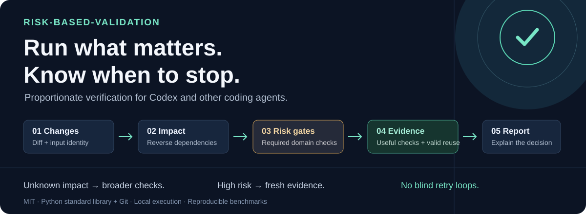

# risk-based-validation

[](https://github.com/l4vid4/risk-based-validation/actions/workflows/ci.yml)
[](LICENSE)
[](pyproject.toml)



**Help your coding agent decide what to verify—and when it has enough evidence to stop.**

After a fix, feature or refactor, select useful checks from reviewed change impact, preserve high-risk gates, explain omissions, and reuse equivalent passing evidence. Built for Codex and other agents that load `SKILL.md`.

[中文说明](README.zh-CN.md) · [Skill](skills/risk-based-validation/SKILL.md) · [CLI/configuration](skills/risk-based-validation/references/configuration.md) · [Research](docs/research.md) · [Design](docs/design.md) · [Measured evaluation](benchmarks/results/local.md)

This is a working Agent Skill plus a small, dependency-free Python CLI. It uses Git evidence and explicit reverse component dependencies; it does not claim to infer every dependency or prove that a passing subset is defect-free. Unknown changes default to the full registered inventory. Repository/user-required checks remain required.

## Try it in a temporary repository

```sh
git clone https://github.com/l4vid4/risk-based-validation.git
cd risk-based-validation
python -m examples.demo
```

The demo runs real checks in a disposable fixture: select **1 of 6** checks for a local refactor, reuse its identical-state pass, then detect a tenant-isolation defect with fresh security checks. It leaves your project untouched. Requires Python 3.10+ and Git.

## Where it helps

| Change | Verification decision |
|---|---|
| A known local component changes | Check that component and affected consumers. |
| Already-passing inputs and context are identical | Reuse trustworthy evidence when explicitly enabled. |
| Permissions, persistence, unknown impact or a failed check | Widen verification and preserve mandatory checks. |
| Required checks are complete | Explain the evidence and stop, instead of repeating unchanged tests. |

## Install

Requirements: Python 3.10+ and Git, on Windows, Linux or macOS. Runtime code uses only the standard library. See the [current CI matrix](https://github.com/l4vid4/risk-based-validation/actions/workflows/ci.yml) and [recorded local validation](docs/validation.md) for exercised environments.

With the optional [community skills CLI](https://github.com/vercel-labs/skills) (Node.js 22.20+), install for Codex:

```sh
npx skills add l4vid4/risk-based-validation --skill risk-based-validation -a codex
```

Then invoke `$risk-based-validation` after a code change. To choose another supported agent, omit `-a codex`. Node is an installer dependency only; the helper uses Python and Git. The third-party installer has its own telemetry policy; see its documentation for opt-out settings.

Download or clone this repository, then copy `skills/risk-based-validation` into the target agent's skill directory. For Codex repository scope, run from this project (replace the target path):

```sh
python tools/install_skill.py --target /path/to/your-project/.agents/skills
```

The installer copies the whole skill, refuses to overwrite an existing installation, and changes no global agent settings. Codex also supports user scope at `~/.agents/skills`. Other agents can load the same `SKILL.md` using their own documented discovery path. Invoke `$risk-based-validation` in Codex; the workflow also works when read manually.

No Python package installation is needed. Optional CLI installation from this repository:

```sh
python -m pip install .
rbv --help
```

This installs the local CLI from source. Prebuilt Skill ZIP and wheel assets are available in [GitHub Releases](https://github.com/l4vid4/risk-based-validation/releases). The package is not published to PyPI.

## Use

Have the agent inspect the diff, acceptance criteria, callers and mandatory checks. It can follow the Skill directly, or register actual repository commands in `.rbv.json`. Start with `impact_reviewed: false`, which selects every registered check. Review paths, dependencies, fixtures and domain checks before enabling selective omission. See the [complete configuration contract](skills/risk-based-validation/references/configuration.md); [`examples/python.json`](examples/python.json) is an adaptation template, not a ready-made inventory for an arbitrary project.

From the target Git root, using the installed skill:

```sh
python .agents/skills/risk-based-validation/scripts/validate.py plan --repo . --base HEAD
python .agents/skills/risk-based-validation/scripts/validate.py run --repo . --base HEAD --execute
```

`plan` reads evidence and prints JSON; it executes no repository test command and writes no state. `run --execute` executes reviewed argv commands in the caller's sandbox. This flag does not grant permissions. No hooks, telemetry, network operations, retries, deployments or background services are installed.

For committed PR changes, pass the reviewed `git merge-base <target-ref> HEAD` commit as `--base`; the default `HEAD` covers only local changes. Add `.rbv/` to `.gitignore`. Results/logs live below `.rbv/`. `--budget 60` limits execution with unresolved work reported as incomplete. It is not an OS resource quota.

Reuse is deliberately opt-in: a check needs `cache: true`, and the invocation needs `--context <dependency-toolchain-external-state-id>`. Context must change with state Git cannot identify. If equivalence is uncertain, omit context or use `--no-cache`. High-risk checks always run fresh.

## How decisions work

- Changes include final worktree, staged changes, deletions, renames and untracked nonignored files. Reverse transitive component dependencies select consumers; changed check inputs select their owners.
- Unreviewed mappings, unknown files, global build/lock/policy inputs and opaque changes broaden to all registered checks. Explicit non-runtime docs can require no executable checks.
- Sensitive path/content hints and custom protected rules force a fresh full inventory with required domain tags. Missing domain or component checks block completion.
- Cost estimates order useful checks; they do not bypass gates. A failure appends unexecuted inventory checks once and remains failed. Diagnostic hints point to logs; there are no blind retries.
- Reuse binds successes to whole-worktree content, configuration, engine/runtime/environment, commands, base, context and intact logs, with bounded age. A final state change invalidates the run.

Exit codes: `0` for `passed` or `no_checks_required`, `1` for executed failure, `2` for incomplete validation/configuration errors. Status and exit code must be considered together; “no checks required” is not a test pass.

## Verify this project

```sh
python -m unittest discover -s tests -t . -v
python -m benchmarks.evaluate --cases 1000 --repetitions 1 --output benchmarks/results/local.json
```

Tests use temporary local Git repositories and real subprocesses. The benchmark compares against direct execution of the complete fixture suite, with no planner overhead added to the baseline. It verifies baseline cleanliness, injects known defects, records failures and actual timings, and checks an intentionally incorrect mapping as a negative control. No sleeps or invented measurements are used. Raw JSON is retained alongside the generated table.

Read the [evaluation notes](docs/evaluation.md) before interpreting results: fewer commands do not necessarily reduce wall time. The fixture is synthetic, mappings are a trust boundary, and small test suites may be cheaper than analysis. Audit selection periodically against full checks through existing CI.

Locally, the 12 primary scenarios detected all 8 known defects with both strategies. Command time fell 25.1%, while end-to-end time increased 39.6%. A [separate larger successful workload](benchmarks/results/scale.md) reduced wall time from 13.537s to 1.837s, with an additional 0.804s cache warmup. These are bounded observations, not a universal speedup claim. See the [local validation record](docs/validation.md) for the 36 behavioral cases (35 passed, one OS-permission skip).

## Layout and scope

```text
skills/risk-based-validation/   portable SKILL.md, references and Python engine
tests/                         selection, execution, cache and CLI regression tests
benchmarks/                    executable fixture, mutations and raw results
examples/                      adaptation templates
tools/                         non-destructive skill installer
docs/                          research, decisions and evaluation limits
.github/workflows/             cross-platform CI definition
```

See [CONTRIBUTING.md](CONTRIBUTING.md) and [SECURITY.md](SECURITY.md). MIT licensed. Future work should focus on native dependency/coverage adapters, larger real-world evaluations and lower analysis overhead, while keeping conservative fallbacks and transparent evidence.

If this helps your workflow, **star the repository** to help others discover it. More valuable still: [share a real workload](https://github.com/l4vid4/risk-based-validation/issues/new/choose), report a skipped-check concern, or contribute a reproducible regression. Negative performance results are welcome.
