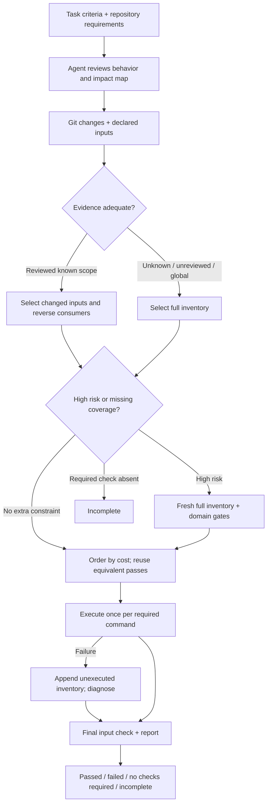

# Design and invariants

## Responsibility split

The agent reads requirements and code semantics; the Skill supplies decision criteria and stopping rules. The CLI provides reproducible mechanics: strict configuration, Git evidence, reverse dependencies, risk/gate checks, execution, bounded escalation, content identity, evidence storage and JSON reports. Existing native test tools remain responsible for executing meaningful assertions.

## Selection algorithm

1. Resolve the base to a commit, never infer a remote target. Read final worktree and staged diffs, untracked paths, and final input content. Disable external diff/textconv processing. Renames become deletion+addition so old/new ownership participates.
2. Collect every owning component and directly changed check input. Compute reverse dependency closure with a visited set. Select checks for each affected component and `always` checks.
3. Recognize explicit non-runtime docs only when not owned by a component/check. Unknown/global/opaque/unreviewed scope forces the full configured inventory. Extra ignored inputs force full selection because Git does not supply their change baseline.
4. Built-in sensitive path/content hints and custom protected paths add required tags and force fresh full selection. Missing component/domain validation is a blocker. Tags and maps are reviewed claims, not coverage proofs.
5. Prioritize gate checks, then ascending estimated cost with stable ID tie-breaks. Estimates are not a quality score and do not waive constraints.

This is linear graph closure by repeated scanning (small explicit graphs) and pattern matching, not a general static-analysis engine. No claim of language-level dependency soundness is made. Whole-input snapshot hashing is linear in file bytes. Bounded textual inspection broadens on large/non-UTF8/binary changes; no truncated diff is accepted as evidence of low risk.

## Execution and evidence

`plan` is read-only with respect to repository files and executes no test command. `run --execute` regenerates the plan; saved plans are not executable authority. Commands are argv arrays using `shell=False`, inherit caller permissions and execute at the Git root. Explicit interpreter/shell commands in a trusted config remain arbitrary code. The helper is not a sandbox.

Each required command executes at most once per run. Any non-pass result triggers one finite expansion to remaining inventory checks. Results remain failures even if unrelated checks pass. Timeout and budget have explicit incomplete/failure outcomes; no retry lottery is implemented. Diagnostic categories are hints, never automatic root-cause proof or authorization to rerun.

An exclusive state-directory lock prevents concurrent helper runs. Source files should also have one writer. The plan captures input identity; the batch ends with a second content/config/base/environment check. A mismatch invalidates the run and prevents new cache entries. This avoids repeated Git sampling before each tiny command. It cannot observe transient external edits that return to the same endpoint; callers needing that property should use an immutable isolated checkout/container.

Evidence reuse is opt-in, local and successful-only, with one-hour default age and one-day maximum. Keys cover whole-worktree content, normalized config, exact test definition, base/root, engine source, Python/platform, full environment digest, resolved executable content and caller external context. Logs must still match their content digest. Reuse does not refresh the original age. A fresh failure deletes a prior success. High-risk and special-input plans bypass cache reads and writes.

Atomic JSON replacements prevent partially written records. Symlinked state paths are rejected. State files are not signed and are not safe attestations across untrusted workspaces. Commands/logs may contain sensitive data; no automatic upload occurs.

## Quality floor and stopping

Stop only when selected plus escalated checks have passing evidence and no blocker or unexplained failure remains. “No checks required” is distinct from a passing test suite. The CLI cannot know whether a test command executed meaningful assertions or whether the inventory is complete; the agent/maintainer must review this.

The full-inventory fallback is deliberately conservative. The helper must not bypass required CI/release checks, change security configuration, weaken assertions or infer permission for external actions. A legitimate small-doc task can stop without adding tests, while a two-line permission change still needs meaningful domain validation.

## Known limitations and next work

- Mapping drift, dynamic dependencies, protocol compatibility and unnamed sensitive semantics need agent review or stronger native adapters. The negative-control experiment demonstrates a real miss under a falsely reviewed map.
- Ignored files/toolchain installations and external services are not inferred. Use `extra_inputs` or trustworthy context IDs; otherwise disable reuse.
- Full means registered inventory. Config cannot prove that a `security` tag checks tenant isolation or a `data` tag checks rollback.
- Final-worktree results do not certify different staged content. Initial repos need a baseline. Submodule and symlink targets require separate evidence.
- Hashing/analysis can dominate small suites; measure end-to-end cost. No inotify daemon, incremental Merkle database or distributed cache is introduced to hide that tradeoff.
- Process-tree timeout cleanup is platform dependent; detached background services and unbounded log size remain limits. A process may exceed the wall budget during planning or cleanup.
- Evaluation uses a synthetic app, not historical production defects. Next steps: native impact/coverage adapters, mapping-drift checks and independently replayed real-project histories; retain the conservative path during adapter uncertainty.
